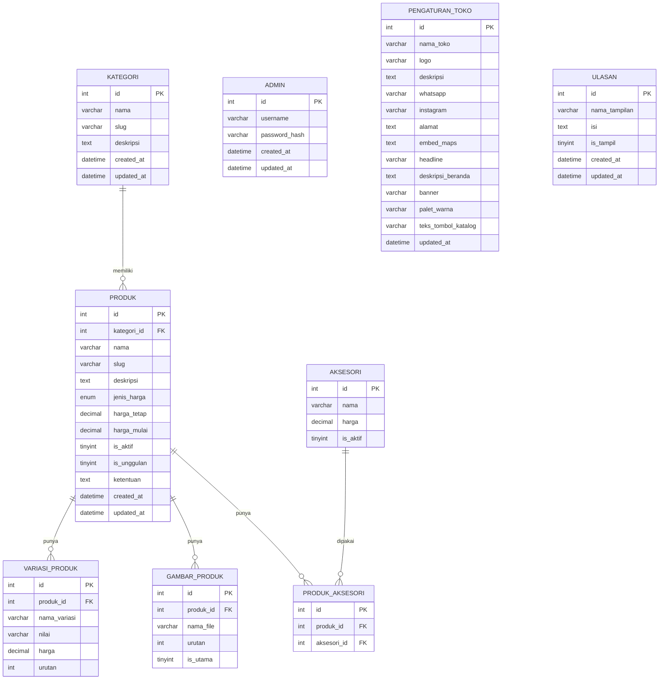
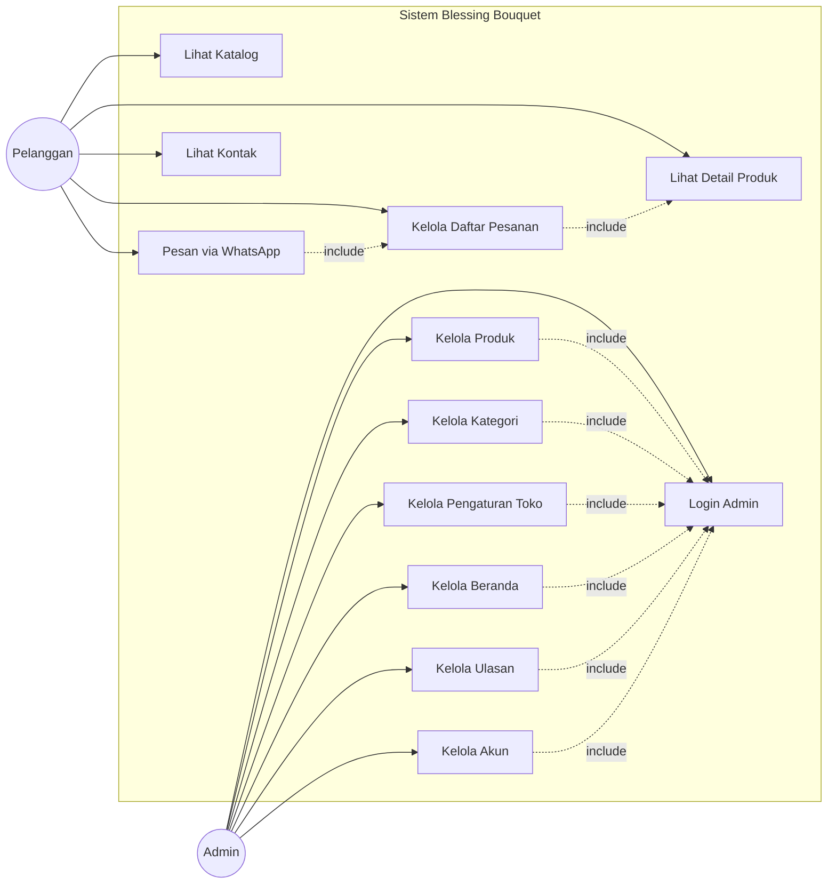
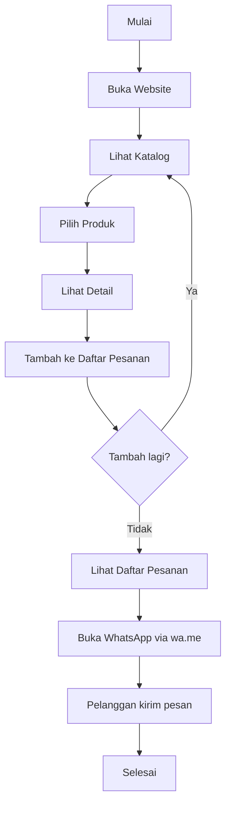
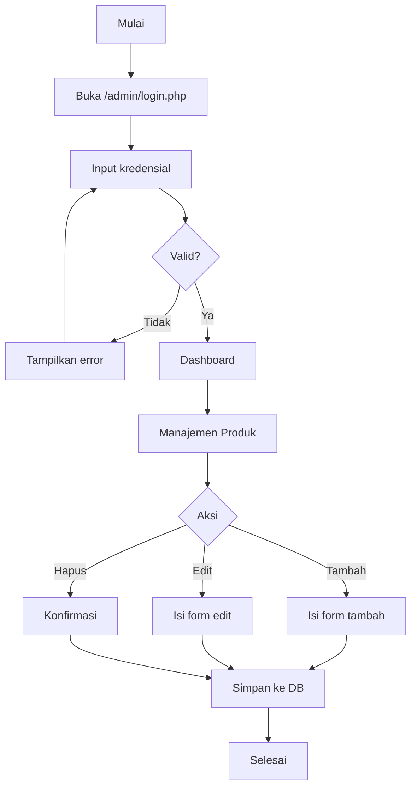
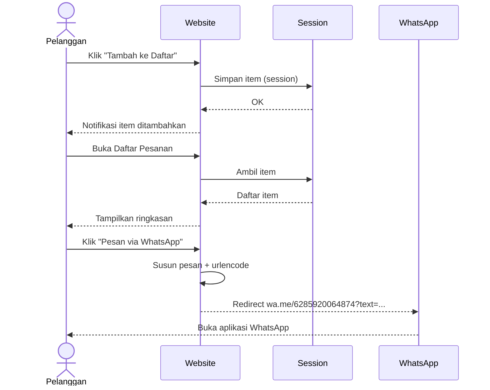
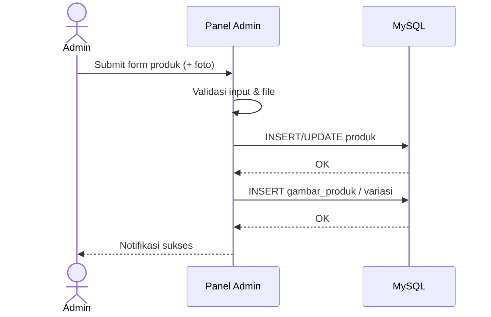
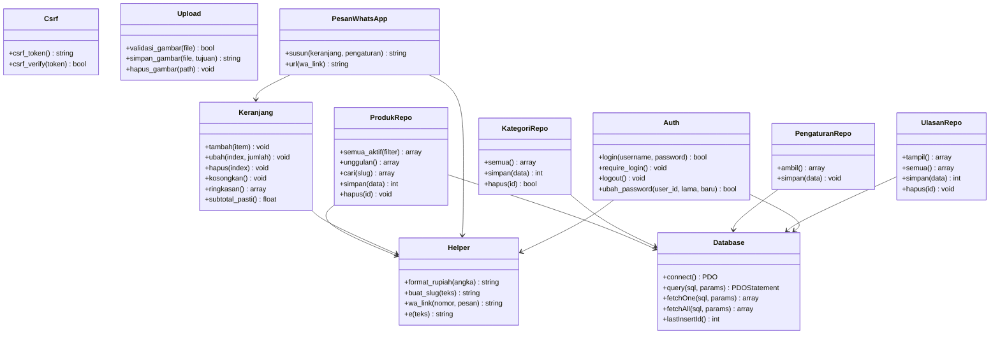
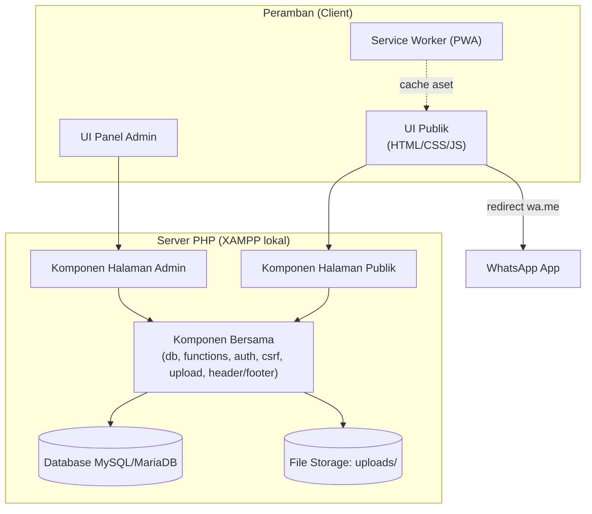
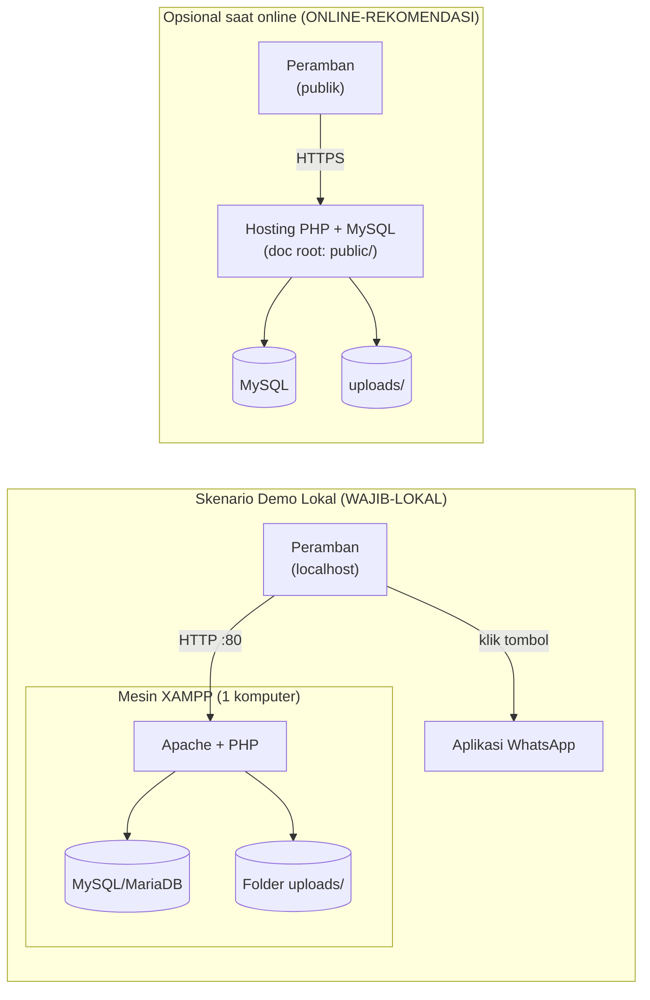

# BLUEPRINT REVISI — WEBSITE BLESSING BOUQUET

> **Versi:** 2.2 (keputusan disetujui + perbaikan kecil)
> **Sumber:** `60225086_Anisah Nurul Hidayah_Blueprint.pdf` (blueprint asli, tidak diubah)
> **Dasar revisi:** hasil analisis pada `ANALISIS-PRODUKSI.md`
> **Status target:** siap demo **lokal (XAMPP)**; publikasi online **ditunda** (opsional)
> **Catatan:** dokumen ini **tidak mengubah** harga, data produk, ketentuan pemesanan, maupun informasi toko yang sudah ditetapkan pada blueprint asli.
> **Status keputusan:** seluruh butir konfirmasi (K-01…K-10) **telah disetujui** — lihat §28 dan `RINGKASAN-PERUBAHAN.md`.

## Penanda kebutuhan

Seluruh dokumen memakai penanda berikut agar jelas mana yang wajib untuk demo lokal dan mana yang baru relevan saat online:

- **[WAJIB-LOKAL]** — harus ada agar demo lokal XAMPP berjalan dan tidak berisiko.
- **[ONLINE-REKOMENDASI]** — tambahan bila kelak dipublikasikan; **bukan syarat** untuk demo lokal dan **tidak boleh mewajibkan layanan berbayar**.
- **[DITAMBAHKAN]** — materi yang tidak ada di blueprint asli namun telah **disetujui** pada keputusan revisi.

### Ringkasan perbaikan utama
1. Struktur folder & document root diperbaiki agar `admin/` dapat diakses dan `includes/`, `database/` terlindungi (kontradiksi pada blueprint asli).
2. Relasi `ADMIN → PRODUK` pada ERD dihapus karena tidak ada kolom/tabel penghubung maupun log.
3. Kolom `pengaturan_toko.teks_tombol_katalog` ditambahkan agar kebutuhan A-06 ("teks tombol") selaras dengan skema.
4. `ulasan.updated_at` ditambahkan karena A-07 mengizinkan edit.
5. Aturan pemodelan harga pada `variasi_produk` diperjelas (satu dimensi); kasus dua dimensi (Pita Satin, Buket Uang) dipisah menjadi produk terpisah — **disetujui (K-04)**.
6. Keamanan dipisah tegas: kontrol lokal XAMPP vs rekomendasi online.
7. Use Case, Class, Component, dan Deployment Diagram dilengkapi/diformalkan (Class/Component/Deployment **[DITAMBAHKAN]**).
8. Fitur PWA **[DITAMBAHKAN]** (manifest + service worker, tanpa framework).
9. Rencana pengujian dilengkapi (blueprint asli terpotong di T-02).

---

## 1. RINGKASAN EKSEKUTIF PROYEK

Blessing Bouquet adalah website katalog dan pemesanan buket berbasis WhatsApp untuk usaha buket skala kecil. Tujuan utama tetap: **katalog produk buket + pemesanan melalui WhatsApp + panel admin**.

Stack yang dipertahankan: **HTML5, CSS3, JavaScript, PHP native, MySQL/MariaDB, dijalankan di XAMPP secara lokal**, target biaya **Rp0**.

Sistem terdiri dari dua bagian:
- **Website publik** — katalog, detail produk, daftar pesanan sementara (session), dan tombol pemesanan ke WhatsApp (tanpa login pelanggan).
- **Panel admin** — mengelola produk, kategori, identitas toko, tampilan beranda, ulasan, dan akun admin.

Pemesanan tidak diproses di dalam sistem. Pelanggan menyusun daftar produk, lalu diarahkan ke WhatsApp dengan pesan tersusun otomatis yang masih dapat diedit.

**Tambahan (disetujui K-01):** aplikasi menyediakan **fitur PWA dasar** **[DITAMBAHKAN]** — manifest, service worker, cache aset statis, halaman fallback offline, dan kemampuan instalasi — agar halaman katalog dapat diakses lebih cepat; tidak memerlukan layanan berbayar. Lihat §24.

---

## 2. LATAR BELAKANG DAN TUJUAN

**Latar belakang:** usaha buket kecil membutuhkan media katalog online yang profesional namun tanpa biaya operasional. Pemesanan tetap dilakukan lewat WhatsApp karena sederhana dan sudah familiar.

**Tujuan:**
1. Menampilkan produk secara menarik dan profesional.
2. Memudahkan pelanggan melihat katalog, variasi, aksesori, dan harga.
3. Memungkinkan pelanggan memilih beberapa produk sebelum menghubungi penjual.
4. Mengarahkan ke WhatsApp dengan pesan pesanan otomatis.
5. Memudahkan pemilik mengelola katalog, foto, logo, dan tampilan tanpa mengubah kode.
6. Menyediakan website responsif, aman, dan dapat dikembangkan.

---

## 3. RUANG LINGKUP DAN BATASAN SISTEM

### 3.1 Termasuk ruang lingkup
- Website publik: beranda, tentang kami, katalog, detail produk, daftar pesanan sementara, kontak, halaman 404.
- Panel admin: login, dashboard, CRUD produk, CRUD kategori, pengaturan toko, pengaturan beranda, manajemen ulasan, akun admin.
- Integrasi WhatsApp via tautan `wa.me` (tanpa API).
- **[DITAMBAHKAN]** PWA dasar (disetujui K-01): `manifest.json`, service worker untuk caching aset statis & halaman publik, halaman fallback offline, ikon aplikasi, dan kemampuan instalasi.

### 3.2 Tidak termasuk ruang lingkup
Pembayaran online, payment gateway, WhatsApp Business API/chatbot berbayar, login pelanggan, checkout transaksi internal, pelacakan status pesanan otomatis, manajemen kurir, POS/kasir, akuntansi, manajemen stok kompleks, editor desain visual, marketplace multi-penjual.

### 3.3 Batasan wajib
- **[WAJIB-LOKAL]** Seluruh proses pengembangan, pengujian, dan demo wajib dapat dilakukan **lokal via XAMPP**.
- **[WAJIB-LOKAL]** Biaya Rp0: tanpa layanan berlangganan, tanpa uji coba berbayar, tanpa kartu kredit/debit, tanpa API berbayar.
- **[WAJIB-LOKAL]** Tidak wajib membeli domain, template, tema, plugin, atau aset.
- **[WAJIB-LOKAL]** Listrik/perangkat pribadi; tidak ada biaya layanan.
- **[ONLINE-REKOMENDASI]** Publikasi online bersifat opsional dan tidak boleh menjadi syarat kelulusan demo.

---

## 4. ANALISIS KEBUTUHAN FUNGSIONAL

### 4.1 Website Publik

| Kode | Kebutuhan | Penanda |
|---|---|---|
| F-01 | Beranda menampilkan header, navigasi, hero, headline, tombol katalog, produk unggulan, kategori, cara pemesanan, ulasan (jika ada), kontak, footer. | WAJIB-LOKAL |
| F-02 | Halaman Tentang Kami menampilkan deskripsi usaha yang dapat diubah admin. | WAJIB-LOKAL |
| F-03 | Katalog menampilkan produk **aktif** (`is_aktif = 1`) dengan foto, nama, deskripsi singkat, harga, kategori, tombol detail, tombol tambah ke daftar. | WAJIB-LOKAL |
| F-04 | Filter kategori dan pencarian nama produk (sederhana) melalui parameter GET. | WAJIB-LOKAL |
| F-05 | Detail produk menampilkan nama, foto, deskripsi, kategori, harga, variasi/aksesori, ketentuan, tombol tambah, tombol WhatsApp. | WAJIB-LOKAL |
| F-06 | Daftar pesanan sementara: tambah, ubah jumlah/variasi, hapus, lihat ringkasan, kosongkan, tambah catatan opsional, lanjut ke WhatsApp. | WAJIB-LOKAL |
| F-07 | Harga ditampilkan sesuai jenisnya: tetap, mulai dari, berdasarkan permintaan, biaya jasa. | WAJIB-LOKAL |
| F-08 | Pemesanan WhatsApp dengan pesan dinamis dan aman (URL-encoded). | WAJIB-LOKAL |
| F-09 | Halaman kontak: WhatsApp, Instagram, alamat, embed Google Maps (jika tersedia). | WAJIB-LOKAL |
| F-10 | Halaman 404 sederhana dengan tombol kembali ke beranda. | WAJIB-LOKAL |
| F-11 | **[DITAMBAHKAN]** PWA: dapat dipasang (installable) dan menyajikan halaman/aset dari cache saat offline terbatas. | DITAMBAHKAN |

**Perbaikan pada F-01/F-04/F-06:** cara implementasi ditambahkan di §26 agar tidak ambigu (mis. F-04 memakai `?kategori=slug&q=...` dengan PDO `LIKE` yang di-escape; F-06 menyimpan struktur keranjang di session — lihat §26.3).

### 4.2 Panel Admin

| Kode | Kebutuhan | Penanda |
|---|---|---|
| A-01 | Login admin dengan **username** + password (hash), validasi, pesan error aman. *(Diselaraskan menjadi username saja — **disetujui K-03**.)* | WAJIB-LOKAL |
| A-02 | Dashboard menampilkan jumlah produk aktif, total produk, kategori, ulasan. | WAJIB-LOKAL |
| A-03 | CRUD produk termasuk foto, kategori, jenis harga, variasi, unggulan, aktif/nonaktif. | WAJIB-LOKAL |
| A-04 | CRUD kategori dengan proteksi saat masih dipakai produk (`ON DELETE RESTRICT`). | WAJIB-LOKAL |
| A-05 | Pengaturan identitas & kontak toko (nama, logo, deskripsi, WhatsApp, Instagram, alamat, embed maps). | WAJIB-LOKAL |
| A-06 | Pengaturan tampilan beranda (headline, deskripsi hero, banner, produk unggulan, teks tombol, palet warna terbatas). | WAJIB-LOKAL |
| A-07 | Manajemen ulasan (tambah, edit, tampil/sembunyi, hapus). | WAJIB-LOKAL |
| A-08 | Akun admin: logout, ubah password, pemeriksaan sesi di semua halaman. | WAJIB-LOKAL |

**Perbaikan pada A-06:** schema `pengaturan_toko` ditambah kolom `teks_tombol_katalog` (default **"Lihat Katalog"**, **disetujui K-05**) agar kebutuhan "teks tombol" punya tempat penyimpanan dan dapat diubah admin. "Produk unggulan" bersumber dari `produk.is_unggulan = 1` (**disetujui K-09**), sesuai F-01 & A-03.

---

## 5. KEBUTUHAN NONFUNGSIONAL

| Aspek | Ketentuan | Penanda |
|---|---|---|
| Biaya | Rp0, tanpa layanan berbayar. | WAJIB-LOKAL |
| Platform | XAMPP (Apache + PHP + MySQL/MariaDB), phpMyAdmin, VS Code. | WAJIB-LOKAL |
| Kompatibilitas | Browser modern (Chrome, Firefox, Edge, Safari). | WAJIB-LOKAL |
| Responsif | Berfungsi di smartphone, tablet, laptop, desktop. | WAJIB-LOKAL |
| Performa | Ringan, tanpa animasi berat, gambar dioptimalkan. | WAJIB-LOKAL |
| Keamanan | PDO prepared statements, escape output, CSRF token, validasi upload, session aman. | WAJIB-LOKAL |
| Pemeliharaan | Struktur folder konsisten, fungsi reusable, kode sederhana. | WAJIB-LOKAL |
| Bahasa | Bahasa Indonesia. | WAJIB-LOKAL |
| Aksesibilitas | Kontras cukup, tipografi mudah dibaca, navigasi jelas. | WAJIB-LOKAL |
| Versioning | Kode disimpan di Git (repository lokal/GitHub gratis). | WAJIB-LOKAL |
| HTTPS | Diperlukan untuk cookie `Secure`, HSTS, dan instalasi PWA di perangkat nyata. | ONLINE-REKOMENDASI |
| Backup | Cadangan database + folder `uploads/` terjadwal. | ONLINE-REKOMENDASI |

---

## 6. DAFTAR HALAMAN PUBLIK

| Halaman | File usulan | Deskripsi |
|---|---|---|
| Beranda | `public/index.php` | Hero, produk unggulan, kategori, cara pesan, ulasan, kontak. |
| Tentang Kami | `public/tentang.php` | Deskripsi usaha. |
| Katalog | `public/katalog.php` | Daftar produk aktif + filter + pencarian. |
| Detail Produk | `public/produk.php?slug=...` | Detail + variasi + aksesori + tombol aksi. |
| Daftar Pesanan | `public/daftar-pesanan.php` | Keranjang sementara berbasis session. |
| Kontak | `public/kontak.php` | WhatsApp, Instagram, alamat, embed Maps. |
| 404 | `public/404.php` | Halaman tidak ditemukan. |
| **[DITAMBAHKAN]** PWA | `public/manifest.json`, `public/sw.js` | Manifest & service worker. | DITAMBAHKAN |

**Catatan struktur:** pada blueprint asli `admin/` berada di luar `public/`, sehingga bila `public/` dijadikan document root, panel admin justru **tidak dapat diakses**. Revisi memindahkan `admin/` **ke dalam** `public/admin/` (lihat §21). `includes/` dan `database/` tetap di luar `public/` sehingga tidak dapat diakses lewat HTTP.

---

## 7. DAFTAR HALAMAN DAN FITUR ADMIN

| Halaman | File usulan | Fitur |
|---|---|---|
| Login | `public/admin/login.php` | Autentikasi, CSRF, validasi. |
| Logout | `public/admin/logout.php` | Hapus sesi. |
| Dashboard | `public/admin/dashboard.php` | Ringkasan data. |
| Produk (list) | `public/admin/produk.php` | Tabel, filter, aksi. |
| Produk (form) | `public/admin/produk-form.php` | Tambah/edit, upload foto, variasi, aksesori. |
| Kategori | `public/admin/kategori.php` | CRUD kategori. |
| Pengaturan Toko | `public/admin/pengaturan-toko.php` | Identitas, kontak, embed maps. |
| Pengaturan Beranda | `public/admin/pengaturan-beranda.php` | Hero, banner, produk unggulan, teks tombol, palet warna. |
| Ulasan | `public/admin/ulasan.php` | CRUD ulasan. |
| Akun | `public/admin/akun.php` | Ubah password. |

---

## 8. USER FLOW PELANGGAN

```
[Buka Website]
     |
     v
[Beranda] --> [Katalog] --> [Detail Produk]
                                |
                                +--> [Tambah ke Daftar Pesanan]
                                |        |
                                |        v
                                |   [Daftar Pesanan]
                                |        |
                                |        + --> [Ubah Jumlah/Variasi]
                                |        + --> [Hapus Item]
                                |        + --> [Kosongkan]
                                |        + --> [Tambah Catatan]
                                |        + --> [Lanjut ke WhatsApp]
                                |                |
                                |                v
                                |   [WhatsApp terbuka dengan pesan otomatis]
                                |
                                +--> [Pesan Langsung via WhatsApp]
```

---

## 9. USER FLOW ADMIN

```
[Buka /admin/login.php]
     |
     v
[Input kredensial] --> [Validasi] --> Gagal --> [Pesan error]
     |
     v Berhasil
[Dashboard]
     |
     +--> [Produk] --> CRUD + upload foto
     +--> [Kategori] --> CRUD
     +--> [Pengaturan Toko] --> Simpan
     +--> [Pengaturan Beranda] --> Simpan
     +--> [Ulasan] --> CRUD
     +--> [Akun] --> Ubah password
     +--> [Logout]
```

---

## 10. RANCANGAN UI/UX DAN PEDOMAN VISUAL

### 10.1 Palet warna

| Peran | Warna | Kode usulan |
|---|---|---|
| Dasar | Ivory/off-white | `#FAF7F2` |
| Aksen utama | Dusty pink | `#D8A7A7` |
| Teks utama | Abu gelap/cokelat lembut | `#4A3F3A` |
| Pendukung | Beige | `#E8DED1` |
| Tombol WhatsApp | Hijau WhatsApp | `#25D366` |

Sediakan 4 palet siap pakai yang dapat dipilih admin. Nama teknis (untuk kolom `palet_warna`) dan label tampilan:

| Nilai kolom | Label |
|---|---|
| `dusty_pink` | Dusty Pink |
| `soft_beige` | Soft Beige |
| `muted_rose` | Muted Rose |
| `sage_green` | Sage Green |

Definisi lengkap 4 palet (**disetujui K-06**). Tombol WhatsApp tetap `#25D366` di semua palet; tiap palet memakai variabel CSS yang sama:

| Peran / Variabel CSS | Dusty Pink | Soft Beige | Muted Rose | Sage Green |
|---|---|---|---|---|
| Dasar (`--warna-dasar`) | `#FAF7F2` | `#FBF8F3` | `#FBF6F5` | `#F6F8F4` |
| Aksen utama (`--warna-aksen`) | `#D8A7A7` | `#D9C3A5` | `#C48A8A` | `#A9BFA0` |
| Teks utama (`--warna-teks`) | `#4A3F3A` | `#4A423A` | `#463A3A` | `#3F463C` |
| Pendukung (`--warna-pendukung`) | `#E8DED1` | `#EFE6D8` | `#EADAD8` | `#DEE7D8` |
| Tombol WhatsApp (`--warna-wa`) | `#25D366` | `#25D366` | `#25D366` | `#25D366` |

**Aturan keterbacaan:** teks utama di atas warna dasar berkontras tinggi pada keempat palet; elemen dengan latar aksen terang memakai teks gelap (`--warna-teks`) dan aksen tidak dipakai sebagai latar teks berjalan. Implementasi cukup mengganti nilai variabel CSS pada `:root` sesuai `palet_warna`.

### 10.2 Tipografi
- Judul: font serif elegan (mis. Playfair Display — gratis Google Fonts).
- Isi: font sans-serif (mis. Inter atau Nunito Sans).
- **Catatan offline:** Google Fonts butuh internet. Agar tampilan tetap rapi saat demo XAMPP/tanpa koneksi, selalu sertakan *font stack* fallback (mis. `Georgia, serif` / `system-ui, sans-serif`), dan idealnya unduh woff2 font untuk disimpan lokal di `assets/fonts/`.

### 10.3 Prinsip
- Banyak ruang kosong, foto produk sebagai fokus.
- Kartu produk konsisten (foto, nama, harga, tombol).
- Tombol WhatsApp selalu terlihat.
- Kondisi kosong informatif, bukan halaman blank.
- Admin: sidebar jelas, form rapi, tabel mudah dibaca, responsif.

### 10.4 Logo & foto
Mekanisme upload dan pengaturan media dibuat sejak awal. Gambar sementara bukan foto asli produk.

---

## 11. STRUKTUR KATALOG DAN MODEL HARGA

### 11.1 Jenis harga (`produk.jenis_harga`)

| Nilai | Arti | Tampilan |
|---|---|---|
| `tetap` | Harga pasti | Rp20.000 |
| `mulai_dari` | Harga awal | Mulai dari Rp20.000 |
| `berdasarkan_permintaan` | Custom | Harga berdasarkan permintaan |
| `biaya_jasa` | Buket uang | Biaya jasa (belum termasuk uang) |

**Aturan penting:**
- Harga belum ditentukan **bukan** Rp0; gunakan `NULL` dan tampilkan "perlu dikonfirmasi".
- Biaya jasa buket uang ≠ total harga buket + uang.
- Produk custom tidak diperlakukan sebagai harga pasti.
- **Harga pasti** (untuk keperluan subtotal) diartikan sebagai: `jenis_harga = 'tetap'` **atau** (`mulai_dari`/`biaya_jasa` yang memiliki variasi terpilih dengan `variasi_produk.harga` **tidak NULL**). Jika tidak ada, subtotal tidak dihitung.

### 11.2 Data awal katalog (dipertahankan apa adanya)

**A. Buket Snack**
- **Buket Mini Snack** — isi ±7 snack — Rp20.000 (biaya snack ±Rp500/snack adalah komponen internal, bukan tambahan ke harga jual).
- **Buket Snack Custom** — mulai dari Rp20.000, snack bisa diminta/dibawa sendiri, harga akhir menyesuaikan.

**B. Buket Uang** — harga = biaya jasa, belum termasuk nominal uang.

Buket Uang Biasa:

| Lembar | Biaya Jasa |
|---|---|
| 10 | Rp35.000 |
| 15 | Rp55.000 |
| 20 | Rp70.000 |
| 25 | Rp90.000 |
| 30 | Rp105.000 |
| 35 | Rp125.000 |
| 40 | Rp140.000 |
| 45 | Rp160.000 |
| 50 | Rp175.000 |

Buket Uang Bentuk:

| Lembar | Biaya Jasa |
|---|---|
| 10 | Rp50.000 |
| 15 | Rp60.000 |
| 20 | Rp80.000 |
| 25 | Rp100.000 |
| 30 | Rp120.000 |
| 35 | Rp140.000 |
| 40 | Rp160.000 |
| 45 | Rp180.000 |
| 50 | Rp200.000 |

**C. Snack Tower** — harga menyesuaikan tingkat & anggaran, dikonfirmasi via WhatsApp.

**D. Buket Pita Satin**

Tanpa Glitter:

| Tangkai | Harga |
|---|---|
| 3 | Rp35.000 |
| 5 | Rp55.000 |
| 7 | Rp65.000 |
| 10 | Rp80.000 |
| 15 | Rp110.000 |
| 20 | Rp140.000 |
| 25 | Rp160.000 |

Dengan Glitter:

| Tangkai | Harga |
|---|---|
| 3 | Rp45.000 |
| 5 | Rp70.000 |
| 7 | Rp85.000 |
| 10 | Rp105.000 |
| 15 | Rp135.000 |
| 20 | Rp160.000 |
| 25 | Rp185.000 |

Aksesori Tambahan:

| Aksesori | Harga |
|---|---|
| Kupu-kupu kecil | Rp5.000 |
| Kupu-kupu besar | Rp7.000 |
| Pita tulisan | Rp10.000 |
| Kartu ucapan | Rp4.000 |
| Mahkota kecil | Rp15.000 |
| Mahkota besar | Rp20.000 |
| Boneka | Rp25.000 |

Ketentuan Buket Pita Satin: estimasi ±7 hari, pilihan warna satin & kertas, pesanan mendesak menyesuaikan stok, pesanan >Rp100.000 perlu DP 50%, pesanan tidak dapat dibatalkan.

**E. Buket Hari Guru** — Rp20.000.

**F. Buket Bunga Artificial**

| Ukuran | Harga |
|---|---|
| S | Rp55.000 |
| M | Rp85.000 |
| L | Rp125.000 |
| Jumbo | Rp150.000 |

**G. Buket Request** — mulai dari Rp20.000, konsultasi via WhatsApp.

**H. Ganci Kawat Bulu** — mulai dari Rp2.000.

### 11.3 Aturan pemodelan variasi (perbaikan)
`variasi_produk` dimaksudkan sebagai **pemilih harga satu dimensi** (mis. "Jumlah Lembar", "Ukuran", "Tangkai"). Satu baris variasi menyimpan `nama_variasi`, `nilai`, dan `harga` (bila memengaruhi harga).

Kasus **dua dimensi** (mis. Pita Satin: Tangkai × Glitter; Buket Uang: Jumlah Lembar × jenis bentuk) **tidak dapat** direpresentasikan sebagai satu matriks harga dalam `variasi_produk`. Solusi yang direkomendasikan tanpa mengubah data: **pisahkan menjadi produk terpisah**, yaitu:
- `Buket Pita Satin (Tanpa Glitter)` dan `Buket Pita Satin (Dengan Glitter)`, masing-masing punya variasi "Tangkai" + harga.
- `Buket Uang Biasa` dan `Buket Uang Bentuk`, masing-masing punya variasi "Jumlah Lembar" + harga.

Harga, nilai, dan ketentuan **tidak diubah**; hanya struktur entri. **Disetujui (K-04):** katalog memakai **dua produk terpisah** untuk Pita Satin (Tanpa/Dengan Glitter) dan **dua produk terpisah** untuk Buket Uang (Biasa/Bentuk).

### 11.4 Aksesori
Aksesori bersifat global (`AKSESORI`) dan dihubungkan ke produk relevan melalui `PRODUK_AKSESORI` (mis. Pita Satin). Aksesori yang dipilih pelanggan ditambahkan sebagai item terpisah pada pesan WhatsApp dengan harga sesuai tabel aksesori.

---

## 12. ERD DAN PENJELASAN RELASI



**Penjelasan relasi:**
- `kategori (1) → produk (N)`: satu kategori punya banyak produk. `ON DELETE RESTRICT` — kategori tidak boleh dihapus jika masih ada produk.
- `produk (1) → variasi_produk (N)`: variasi seperti jumlah lembar, tangkai, ukuran, glitter. `ON DELETE CASCADE`.
- `produk (1) → gambar_produk (N)`: mendukung banyak foto. `ON DELETE CASCADE`.
- `produk (N) ←→ aksesori (N)` via `produk_aksesori`: hanya untuk produk relevan (mis. Pita Satin). `ON DELETE CASCADE`.
- `pengaturan_toko` dan `ulasan` berdiri sendiri.

**Perbaikan relasi:** blueprint asli menampilkan `ADMIN ||--o{ PRODUK : "mengelola (log)"`, padahal `produk` tidak memiliki kolom `admin_id` dan tidak ada tabel log. Relasi ini **dihapus** dan **audit log tidak digunakan (disetujui K-08)** karena di luar kebutuhan proyek.

---

## 13. DAFTAR TABEL DAN STRUKTUR KOLOM DATABASE

### 13.1 `admin`

| Kolom | Tipe | Keterangan |
|---|---|---|
| `id` | INT AI PK | |
| `username` | VARCHAR(50) UNIQUE | Hanya username (tanpa email) — **disetujui K-03**. |
| `password_hash` | VARCHAR(255) | hasil `password_hash()`. |
| `created_at` | DATETIME | |
| `updated_at` | DATETIME NULL | |

### 13.2 `kategori`

| Kolom | Tipe | Keterangan |
|---|---|---|
| `id` | INT AI PK | |
| `nama` | VARCHAR(100) | |
| `slug` | VARCHAR(120) UNIQUE | |
| `deskripsi` | TEXT NULL | |
| `created_at` | DATETIME | |
| `updated_at` | DATETIME NULL | |

### 13.3 `produk`

| Kolom | Tipe | Keterangan |
|---|---|---|
| `id` | INT AI PK | |
| `kategori_id` | INT FK → `kategori.id` | `ON DELETE RESTRICT` |
| `nama` | VARCHAR(150) | |
| `slug` | VARCHAR(180) UNIQUE | |
| `deskripsi` | TEXT | |
| `jenis_harga` | ENUM('tetap','mulai_dari','berdasarkan_permintaan','biaya_jasa') | |
| `harga_tetap` | DECIMAL(12,2) NULL | diisi jika `tetap` |
| `harga_mulai` | DECIMAL(12,2) NULL | diisi jika `mulai_dari` |
| `is_aktif` | TINYINT(1) DEFAULT 1 | |
| `is_unggulan` | TINYINT(1) DEFAULT 0 | |
| `ketentuan` | TEXT NULL | |
| `created_at` | DATETIME | |
| `updated_at` | DATETIME NULL | |

### 13.4 `variasi_produk`

| Kolom | Tipe | Keterangan |
|---|---|---|
| `id` | INT AI PK | |
| `produk_id` | INT FK → `produk.id` | `ON DELETE CASCADE` |
| `nama_variasi` | VARCHAR(80) | mis. "Jumlah Lembar", "Tangkai" |
| `nilai` | VARCHAR(100) | mis. "10 lembar", "5 tangkai" |
| `harga` | DECIMAL(12,2) NULL | NULL jika tidak ada harga khusus |
| `urutan` | INT DEFAULT 0 | |

### 13.5 `aksesori`

| Kolom | Tipe | Keterangan |
|---|---|---|
| `id` | INT AI PK | |
| `nama` | VARCHAR(80) | |
| `harga` | DECIMAL(12,2) | |
| `is_aktif` | TINYINT(1) DEFAULT 1 | |

### 13.6 `produk_aksesori`

| Kolom | Tipe | Keterangan |
|---|---|---|
| `id` | INT AI PK | |
| `produk_id` | INT FK | `ON DELETE CASCADE` |
| `aksesori_id` | INT FK | `ON DELETE CASCADE` |
| | | `UNIQUE(produk_id, aksesori_id)` |

### 13.7 `gambar_produk`

| Kolom | Tipe | Keterangan |
|---|---|---|
| `id` | INT AI PK | |
| `produk_id` | INT FK | `ON DELETE CASCADE` |
| `nama_file` | VARCHAR(255) | nama file tersimpan |
| `urutan` | INT DEFAULT 0 | |
| `is_utama` | TINYINT(1) DEFAULT 0 | hanya satu gambar utama per produk (dijaga di level aplikasi). |

### 13.8 `pengaturan_toko` (satu baris, `id = 1`)

| Kolom | Tipe | Keterangan |
|---|---|---|
| `id` | INT AI PK | Selalu `1` (dijaga di level aplikasi). |
| `nama_toko` | VARCHAR(120) | |
| `logo` | VARCHAR(255) NULL | |
| `deskripsi` | TEXT NULL | |
| `whatsapp` | VARCHAR(20) | format 6285... |
| `instagram` | VARCHAR(120) NULL | |
| `alamat` | TEXT NULL | |
| `embed_maps` | TEXT NULL | |
| `headline` | VARCHAR(200) NULL | |
| `deskripsi_beranda` | TEXT NULL | |
| `banner` | VARCHAR(255) NULL | |
| `palet_warna` | VARCHAR(40) DEFAULT 'dusty_pink' | whitelist §10.1 |
| `teks_tombol_katalog` | VARCHAR(60) DEFAULT 'Lihat Katalog' | **[perbaikan A-06 — disetujui K-05]** |
| `updated_at` | DATETIME | |

### 13.9 `ulasan`

| Kolom | Tipe | Keterangan |
|---|---|---|
| `id` | INT AI PK | |
| `nama_tampilan` | VARCHAR(80) | |
| `isi` | TEXT | |
| `is_tampil` | TINYINT(1) DEFAULT 1 | |
| `created_at` | DATETIME | |
| `updated_at` | DATETIME NULL | **[perbaikan A-07]** |

**Ketentuan SQL:**
- Semua nominal rupiah pakai `DECIMAL(12,2)`.
- Harga belum diketahui → `NULL`, bukan 0.
- Skrip `database.sql` harus idempotent (`CREATE TABLE IF NOT EXISTS`).
- Seed data katalog dari §11.2.
- Password admin awal **tidak** ditanam di SQL; dibuat via `database/install.php` (aman, minta input) lalu file tersebut dihapus setelah dipakai **[WAJIB-LOKAL]**.

---

## 14. USE CASE DIAGRAM



**Catatan perbaikan:** blueprint asli hanya menuliskan daftar use case sebagai teks. Revisi memformalkannya menjadi diagram dengan aktor dan relasi `include` (mis. semua use case admin menyertakan Login Admin sebagai prasyarat sesi).

---

## 15. ACTIVITY DIAGRAM

### 15.1 Pelanggan: pilih produk → WhatsApp



### 15.2 Admin: login & kelola produk



---

## 16. SEQUENCE DIAGRAM

### 16.1 Pelanggan menambah produk & buka WhatsApp



### 16.2 Admin menambah/memperbarui produk



---

## 17. CLASS DIAGRAM **[DITAMBAHKAN]**

Karena aplikasi memakai **PHP native (prosedural)**, "kelas" di bawah adalah **kelas logis** yang merepresentasikan tanggung jawab modul; implementasinya boleh berupa fungsi dalam `includes/`. Diagram ini ditambahkan karena diminta pada instruksi revisi dan untuk memastikan tanggung jawab tidak tumpang tindih.



---

## 18. COMPONENT DIAGRAM **[DITAMBAHKAN]**



---

## 19. DEPLOYMENT DIAGRAM **[DITAMBAHKAN]**



**Catatan:** server PHP **tidak** mengirim pesan WhatsApp otomatis; WhatsApp hanya menerima pengalihan dari peramban pelanggan. Tidak diperlukan WhatsApp API.

---

## 20. DIAGRAM ARSITEKTUR APLIKASI

```
 Client                         Server Lokal XAMPP
+------------------+           +------------------------------+
| Browser Pelanggan| --HTTP--> |  PHP Native --> MySQL/MariaDB |
| Browser Admin    | -HTTP+--> |             --> File /uploads |
|                  |  Session  +------------------------------+
+------------------+
        .
        . (klik tombol)
        v
   WhatsApp App
```

---

## 21. STRUKTUR FOLDER DAN PENJELASAN FILE (diperbaiki)

```
blessing-bouquet/                     # root proyek (bukan document root)
├── public/                           # DOCUMENT ROOT (XAMPP: arahkan ke sini)
│   ├── index.php                     # Beranda
│   ├── tentang.php                   # Tentang Kami
│   ├── katalog.php                   # Katalog
│   ├── produk.php                    # Detail produk
│   ├── daftar-pesanan.php            # Keranjang sementara
│   ├── kontak.php                    # Kontak & lokasi
│   ├── 404.php                       # Halaman tidak ditemukan
│   ├── manifest.json                 # [DITAMBAHKAN] PWA
│   ├── sw.js                         # [DITAMBAHKAN] service worker
│   ├── admin/                        # Panel admin (dipindah ke dalam public/)
│   │   ├── login.php
│   │   ├── logout.php
│   │   ├── dashboard.php
│   │   ├── produk.php
│   │   ├── produk-form.php
│   │   ├── kategori.php
│   │   ├── pengaturan-toko.php
│   │   ├── pengaturan-beranda.php
│   │   ├── ulasan.php
│   │   ├── akun.php
│   │   └── assets/
│   │       ├── css/admin.css
│   │       └── js/admin.js
│   ├── assets/
│   │   ├── css/style.css
│   │   ├── js/main.js
│   │   └── img/                      # Placeholder gambar + ikon PWA
│   └── uploads/
│       ├── .htaccess                 # tolak eksekusi PHP
│       ├── produk/
│       └── toko/
│
├── includes/                         # DI LUAR doc root → tidak dapat diakses HTTP
│   ├── config.php                    # kredensial DB (TIDAK di-commit)
│   ├── config.example.php            # contoh untuk Git
│   ├── db.php                        # koneksi PDO
│   ├── functions.php                 # format_rupiah, buat_slug, wa_link, e
│   ├── auth.php                       # require_login()
│   ├── csrf.php                      # csrf_token(), csrf_verify()
│   ├── upload.php                     # validasi & simpan gambar
│   ├── header.php                     # header publik
│   ├── footer.php                     # footer publik
│   └── admin-header.php               # header admin
│
├── database/
│   ├── database.sql                  # skema + seed
│   └── install.php                   # buat admin pertama (hapus setelah dipakai)
│
├── docs/
│   ├── BLUEPRINT-REVISI.md           # dokumen ini
│   └── diagrams/
│
├── .htaccess                         # proteksi & ErrorDocument 404
└── README.md
```

**Perubahan & alasan:**
- `admin/` dipindah ke dalam `public/` agar dapat diakses web saat document root = `public/`.
- `includes/` dan `database/` tetap di luar document root sehingga tidak dapat diakses lewat URL.
- Ditambahkan `config.example.php`, `.htaccess` proteksi, `manifest.json`, `sw.js`, ikon PWA.

**Tanggung jawab file utama:**
- `includes/config.php` — kredensial DB; **jangan** di-commit. Sediakan `config.example.php` di Git.
- `includes/db.php` — satu koneksi PDO dipakai ulang.
- `includes/functions.php` — `format_rupiah()`, `buat_slug()`, `wa_link()`, `e()`.
- `includes/auth.php` — `require_login()` di semua halaman admin.
- `includes/csrf.php` — `csrf_token()`, `csrf_verify()`.
- `includes/upload.php` — cek MIME, ekstensi, ukuran; rename acak.
- `database/install.php` — form buat admin pertama; **hapus/lindungi setelah dipakai**.

---

## 22. RANCANGAN KEAMANAN APLIKASI

Tabel dibagi menjadi kontrol **wajib untuk demo lokal XAMPP** dan **rekomendasi saat online**. Tidak ada yang mewajibkan layanan berbayar.

### 22.1 Wajib untuk demo lokal [WAJIB-LOKAL]

| # | Kontrol | Implementasi | Contoh |
|---|---|---|---|
| 1 | SQL Injection | PDO + prepared statements | `SELECT * FROM produk WHERE slug = ?` |
| 2 | Validasi input | Server-side untuk semua form | cek tipe, panjang, whitelist enum |
| 3 | XSS | Escape output di semua tempat | `htmlspecialchars($v, ENT_QUOTES, 'UTF-8')` via `e()` |
| 4 | Password | `password_hash()` + `password_verify()` | jangan simpan plaintext |
| 5 | Sesi | `session_regenerate_id(true)` setelah login; `require_login()` | semua halaman admin |
| 6 | Cookie sesi | `HttpOnly` + `SameSite=Lax` | `session_set_cookie_params` |
| 7 | CSRF | Token di semua form yang mengubah data | `csrf_token()` + `csrf_verify()` |
| 8 | Upload | Cek MIME (jpeg/png/webp), ekstensi whitelist, ukuran maks | tolak selain gambar |
| 9 | Nama file | Rename acak | `bin2hex(random_bytes(8))` |
| 10 | Eksekusi file | `.htaccess` di `uploads/` menolak eksekusi PHP | `php_flag engine off` |
| 11 | Proteksi folder | `includes/` & `database/` di luar doc root (+ `.htaccess` deny) | jangan dapat diakses URL |
| 12 | URL embed | Whitelist host: `wa.me`, `instagram.com`, `google.com/maps` | tolak iframe di luar itu |
| 13 | Error DB | Pesan umum ke pengguna; detail ke log | `error_log()` |
| 14 | Hapus data | Konfirmasi UI + cek relasi sebelum delete | tangkap error FK RESTRICT |
| 15 | Method check | Cek `$_SERVER['REQUEST_METHOD']==='POST'` sebelum proses | tolak GET untuk aksi ubah |
| 16 | install.php | Hapus/lindungi setelah dipakai | cegah pembuatan admin liar |
| 17 | Config | Pisahkan `config.php` (rahasia) & `config.example.php` | jangan commit kredensial |

### 22.2 Rekomendasi saat online [ONLINE-REKOMENDASI]

| # | Kontrol | Alasan |
|---|---|---|
| 1 | HTTPS + HSTS | Wajib agar cookie `Secure` dan PWA berjalan aman |
| 2 | Cookie `Secure` | Hanya kirim cookie via HTTPS |
| 3 | Header: `X-Content-Type-Options`, `X-Frame-Options`, `Referrer-Policy` | Cegah MIME sniffing, clickjacking, kebocoran referrer |
| 4 | CSP | Membatasi sumber skrip/aset |
| 5 | Rate-limit login | Cegah brute force password admin |
| 6 | `display_errors=Off` + log | Jangan bocorkan detail error ke pengguna |
| 7 | Backup terjadwal | DB + `uploads/` |
| 8 | Update PHP/MySQL | Patch keamanan |

> Header seperti `X-Content-Type-Options`, `X-Frame-Options`, `Referrer-Policy` **aman juga dipasang saat lokal** lewat `.htaccess` Apache XAMPP, tetapi sifatnya hanya rekomendasi tambahan; yang **wajib** untuk demo lokal adalah baris pada §22.1.

---

## 23. RANCANGAN PEMESANAN WHATSAPP

Nomor: `085920064874` → `https://wa.me/6285920064874`

**Alur:**
1. Pelanggan klik "Pesan via WhatsApp" di halaman daftar pesanan.
2. Website menyusun teks pesan dari session.
3. Teks di-`urlencode` dan digabung ke `https://wa.me/6285920064874?text=....`
4. Browser membuka WhatsApp; pelanggan masih dapat mengedit pesan.
5. Server tidak mengirim pesan otomatis.

**Contoh format pesan:**
```
Halo, saya ingin memesan produk dari Blessing Bouquet.

Daftar pesanan:
1. Buket Pita Satin (Dengan Glitter)
   - Variasi: 10 tangkai
   - Jumlah: 1
   - Harga: Rp105.000

2. Buket Uang Biasa
   - Variasi: 20 lembar
   - Jumlah: 1
   - Biaya jasa: Rp70.000 (belum termasuk nominal uang)

Catatan tambahan: [Catatan pelanggan]

Mohon informasi ketersediaan produk, detail pesanan, dan total harga yang perlu dibayarkan. Terima kasih.
```

**Aturan dinamis:**
- Buket Uang → tulis "biaya jasa pembuatan, belum termasuk nominal uang".
- Produk custom / berdasarkan permintaan → tulis "harga akhir perlu dikonfirmasi".
- Harga belum pasti → jangan tampilkan sebagai Rp0; tampilkan "perlu dikonfirmasi".
- Subtotal hanya ditampilkan jika semua item punya harga pasti (§11.1); jika tidak, tulis "total akhir dikonfirmasi via WhatsApp".
- Nomor WhatsApp diambil dari `pengaturan_toko.whatsapp` sehingga bisa diubah admin.

---

## 24. PWA (DASAR) **[DITAMBAHKAN — disetujui K-01]**

Fitur PWA **dasar** disetujui sesuai keputusan K-01. Tidak memerlukan framework atau layanan berbayar.

**Cakupan yang disetujui:**
- `public/manifest.json` — `name`, `short_name`, `icons` (192px & 512px), `start_url`, `display: standalone`, `theme_color`, `background_color`.
- `public/sw.js` — service worker dasar:
  - cache **aset statis** (CSS, JS, ikon, font) dengan strategi *cache-first*;
  - cache halaman publik (beranda/katalog/detail) dengan strategi *network-first* + fallback cache;
  - **halaman fallback offline** sederhana bila jaringan mati.
- **Kemampuan instalasi** pada perangkat yang mendukung (Add to Home Screen).
- Pendaftaran service worker dari `assets/js/main.js`; ikon di `assets/img/`.

**Batas tegas:** **keranjang dan seluruh data dinamis tetap membutuhkan koneksi** ke server (session tidak disimpan offline); aksi panel admin **tidak** di-cache.

**Catatan [ONLINE-REKOMENDASI]:** instalasi penuh di perangkat nyata idealnya lewat **HTTPS**. Saat lokal, `localhost` umumnya dianggap secure context oleh browser modern sehingga pengujian dasar tetap dapat dilakukan.

---

## 25. RENCANA PENGUJIAN DAN TEST CASE

> Blueprint asli terpotong pada T-02. Tabel berikut melengkapi rencana pengujian. Status awal: **Belum diuji**.

### 25.1 Website publik

| ID | Skenario | Hasil Diharapkan | Status |
|---|---|---|---|
| T-01 | Beranda dibuka (`/`) | Halaman tampil lengkap | Belum |
| T-02 | Produk aktif tampil di katalog | Hanya `is_aktif=1` yang muncul | Belum |
| T-03 | Filter kategori | Daftar terfilter sesuai kategori | Belum |
| T-04 | Pencarian nama produk | Hasil sesuai kata kunci | Belum |
| T-05 | Detail produk (`?slug=`) | Data + variasi + aksesori tampil | Belum |
| T-06 | Tambah ke daftar pesanan | Item tersimpan di session | Belum |
| T-07 | Ubah jumlah/variasi | Ringkasan ikut berubah | Belum |
| T-08 | Hapus item | Item hilang dari ringkasan | Belum |
| T-09 | Kosongkan daftar | Keranjang kosong | Belum |
| T-10 | Lanjut ke WhatsApp | Pesan tersusun & ter-`urlencode` benar | Belum |
| T-11 | Tampilan harga per jenis | tetap/mulai/permintaan/biaya jasa benar | Belum |
| T-12 | Kontak & embed Maps | Kontak tampil; embed valid | Belum |
| T-13 | Halaman 404 | Muncul 404 + tombol beranda | Belum |
| T-14 | Produk nonaktif via URL | Tidak dapat diakses langsung | Belum |

### 25.2 Keamanan

| ID | Skenario | Hasil Diharapkan | Status |
|---|---|---|---|
| T-15 | Submit form tanpa token CSRF | Ditolak | Belum |
| T-16 | Akses halaman admin tanpa login | Redirect ke login | Belum |
| T-17 | Upload file non-gambar (selain JPEG/PNG/WebP) | Ditolak dengan pesan aman | Belum |
| T-18 | Akses `includes/config.php` via URL | Ditolak / tidak ditemukan | Belum |
| T-19 | Akses eksekusi PHP di `uploads/` | Ditolak | Belum |
| T-20 | Input berisi tag HTML | Tampil sebagai teks (tidak dieksekusi) | Belum |
| T-31 | Jumlah item ≤ 0 atau non-angka | Ditolak dengan pesan aman | Belum |
| T-32 | `jenis_harga` tidak valid / slug duplikat dari panel | Ditolak / ditangani otomatis | Belum |

### 25.3 Panel admin

| ID | Skenario | Hasil Diharapkan | Status |
|---|---|---|---|
| T-21 | Login valid/tidak valid | Sesuai; error tidak membocorkan detail | Belum |
| T-22 | CRUD produk + upload foto | Data & gambar tersimpan | Belum |
| T-23 | Hapus kategori yang masih dipakai | Ditolak (RESTRICT) dengan pesan jelas | Belum |
| T-24 | Simpan pengaturan toko | Tersimpan & tampil di publik | Belum |
| T-25 | Simpan pengaturan beranda | Tersimpan & tampil di beranda | Belum |
| T-26 | Ulasan tampil/sembunyi | Perubahan tampilan sesuai | Belum |
| T-27 | Ubah password | Password lama gagal, baru berhasil | Belum |

### 25.4 PWA & responsif [DITAMBAHKAN]

| ID | Skenario | Hasil Diharapkan | Status |
|---|---|---|---|
| T-28 | Manifest terbaca | Browser menawarkan "pasang" (di `localhost`/HTTPS) | Belum |
| T-29 | Halaman katalog saat offline | Menampilkan versi cache / halaman fallback offline | Belum |
| T-30 | Tampilan mobile/desktop | Tata letak responsif | Belum |

---

## 26. KONVENSI IMPLEMENTASI & KUMPULAN HELPER

### 26.1 Helper dasar (`includes/functions.php`)
- `format_rupiah($angka)` → `"Rp20.000"`; untuk `NULL` kembalikan `"perlu dikonfirmasi"` (bukan `Rp0`).
- `buat_slug($teks)` → slug aman; jika sudah ada, tambahkan akhiran `-2`, `-3`, dst.
- `wa_link($nomor, $pesan)` → `https://wa.me/<nomor>?text=<urlencode($pesan)>`.
- `e($teks)` → `htmlspecialchars($teks, ENT_QUOTES, 'UTF-8')`.

### 26.2 Koneksi & konfigurasi
- `includes/config.php` berisi kredensial; salin dari `config.example.php`.
- `includes/db.php` membuat satu instance `PDO` dengan `ERRMODE_EXCEPTION` dan `charset=utf8mb4`.

### 26.3 Struktur keranjang (session) — *diperjelas*
Keranjang disimpan pada `$_SESSION['keranjang']` sebagai array item:

```
item = [
  'produk_id'    => int,
  'nama'         => string,          // snapshot nama
  'jenis_harga'  => string,          // tetap|mulai_dari|berdasarkan_permintaan|biaya_jasa
  'variasi'      => [ 'nama' => string, 'nilai' => string, 'harga' => float|NULL ],
  'aksesori'     => [ [nama, harga], ... ],   // opsional
  'jumlah'       => int,
  'harga_tampil' => float|NULL,      // snapshot harga saat ditambahkan
]
catatan = string (opsional)
```

Aturan: karena session bersifat sementara dan harga dapat berubah di DB, `harga_tampil` dipakai **snapshot** saat item ditambahkan agar ringkasan konsisten.

### 26.4 Upload (`includes/upload.php`)
- Terima hanya `image/jpeg`, `image/png`, `image/webp`; cek juga `getimagesize()`.
- Ukuran maksimum **2 MB**, divalidasi di sisi server (**disetujui K-07**).
- Nama file: `bin2hex(random_bytes(8)) . '.' . $ekstensi`.

### 26.5 Halaman 404
- Set `ErrorDocument 404 /404.php` pada `.htaccess`; jika disajikan pada subfolder XAMPP, gunakan path relatif yang sesuai.

---

## 27. DEPLOYMENT LOKAL (XAMPP) & CATATAN ONLINE

### 27.1 Lokal [WAJIB-LOKAL]
1. Salin folder `blessing-bouquet` ke `C:\xampp\htdocs\`.
2. Buat virtual host Apache yang mengarah ke `.../blessing-bouquet/public`. *(Alternatif tanpa vhost — mengakses `http://localhost/blessing-bouquet/public/` — **hanya** diperbolehkan bila root `blessing-bouquet/.htaccess` secara eksplisit menolak akses ke `includes/` dan `database/`. Tanpa itu, kedua folder terpapar lewat URL karena doc root adalah `htdocs/`.)*
3. Import `database/database.sql` melalui phpMyAdmin.
4. Salin `config.example.php` → `config.php`, isi kredensial DB.
5. Buka `database/install.php` untuk membuat admin pertama, lalu **hapus** file tersebut.
6. Pastikan `mod_rewrite` dan `AllowOverride All` aktif agar `.htaccess` bekerja.

### 27.2 Online [ONLINE-REKOMENDASI]
- Arahkan document root ke `public/`; aktifkan HTTPS.
- Terapkan kontrol §22.2 dan uji ulang seluruh test case.
- Tidak ada syarat layanan berbayar.

---

## 28. KEPUTUSAN YANG TELAH DISETUJUI

Seluruh butir konfirmasi (K-01…K-10) telah disetujui dan diterapkan pada dokumen ini:

| # | Keputusan yang disetujui | Terdampak pada |
|---|---|---|
| K-01 | **PWA dasar**: manifest, service worker, cache aset statis, halaman fallback offline, dapat dipasang; keranjang & data dinamis tetap perlu koneksi. | §3.1, §4.1 (F-11), §6, §24, §25.4 |
| K-02 | **Class, Component, Deployment Diagram** dilengkapi sesuai arsitektur PHP native + MySQL/MariaDB + XAMPP. | §17–§19 |
| K-03 | Login admin memakai **username + password**. | §4.2 (A-01), §13.1 |
| K-04 | **Pita Satin** dipisah menjadi *Tanpa Glitter* & *Dengan Glitter*; **Buket Uang** dipisah menjadi *Biasa* & *Bentuk*. Harga & ketentuan dipertahankan. | §11.2, §11.3 |
| K-05 | Teks tombol beranda default **"Lihat Katalog"**, dapat diubah melalui panel admin. | §13.8, §4.2 (A-06) |
| K-06 | Palet **Soft Beige, Muted Rose, Sage Green** ditetapkan serasi dengan Dusty Pink, tetap nyaman dibaca. | §10.1 |
| K-07 | Batas upload gambar **maks 2 MB** dengan validasi sisi server. | §22.1, §26.4 |
| K-08 | **Tanpa audit log** (di luar kebutuhan proyek). | §12 |
| K-09 | Produk unggulan beranda bersumber dari kolom **`is_unggulan`**. | §4.2 (A-06), §13.3 |
| K-10 | **Hosting online ditunda**; fokus demo lokal XAMPP tanpa layanan berbayar. | §1, §3.3, §27.2 |

**Tidak ada keputusan yang membuka kembali data produk, harga, atau ketentuan pemesanan.**

---

*Dokumen ini adalah revisi blueprint untuk implementasi lokal. Tidak ada kode aplikasi yang dibuat pada tahap ini.*
